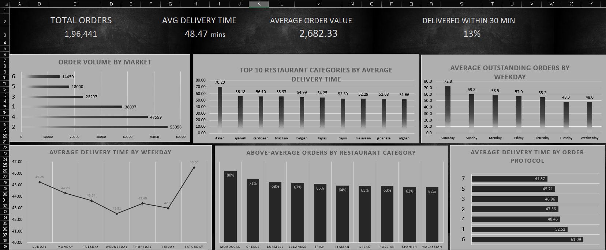

# Porter Delivery Analytics Project

This repository documents a delivery performance analysis project for a food-delivery platform using Porter delivery data. The goal of the project is to study order flow, delivery efficiency, market-level demand, restaurant category behavior, and partner workload to identify patterns that can improve delivery speed and operational decisions.

## Project Overview

The project analyzes a dataset of delivery orders using Excel-based business intelligence workflows. It focuses on understanding:

- Where the highest order volumes occur
- Which markets and restaurant categories are slowest
- When demand peaks during the day and week
- How order value, product mix, and workload affect delivery time
- Which operational issues should be prioritized for improvement

The analysis combines business questions, KPI tracking, PivotTables, and dashboard visuals to provide clear decision-making insights for operations teams.

## Repository Contents

- `Solutions.md` — detailed analytical findings, KPIs, trends, and recommendations
- `dashboard.png` — project dashboard overview
- `images/` — screenshots of the workbook and analysis views

## Business Objective

Porter aims to improve delivery experience by reducing average delivery time, improving market coverage, and identifying bottlenecks in the order-to-delivery process. This project is useful for:

- Operations planning
- Delivery partner optimization
- Market productivity analysis
- Restaurant performance review
- Data-driven decision support

## Requirements

To reproduce or extend this project, the following requirements are useful:

- Microsoft Excel or Excel-compatible spreadsheet software
- Microsoft Excel 365 recommended for better processing and compatibility
- A dataset containing delivery order, market, timing, order value, and restaurant information
- Basic understanding of data cleaning, PivotTables, formulas, and dashboard design
- Optional: Power Query and charting features for more robust analysis

### Dataset Used

The project uses the Porter Delivery Time Estimation dataset from Kaggle.

- Source: https://www.kaggle.com/datasets/ranitsarkar01/porter-delivery-time-estimation

## Tools and Technologies

The project primarily uses Microsoft Excel and built-in analytical features:

- Microsoft Excel
- PivotTables
- PivotCharts
- Data validation and cleaning
- Helper columns and calculated fields
- Conditional formatting
- KPI summaries and slicer-like dashboard layout

This project is a strong example of business analytics done with spreadsheet tools rather than traditional software engineering or Python data science workflows.

## Project Workflow

The workflow followed in this project was:

1. Import the delivery dataset into Excel
2. Review missing values, unusual observations, and data quality issues
3. Create cleaned helper fields for analysis
4. Build PivotTables for market, category, time, and partner metrics
5. Calculate KPIs such as average delivery time and order value
6. Interpret business trends and identify operational bottlenecks
7. Summarize findings in a dashboard and report

## Key Findings

The analysis exposed several important trends:

- Market 2 and Market 4 had the highest order volumes
- Saturday and Sunday were peak order days
- The largest order activity occurred late night and early morning
- Italian cuisine and some other categories had the slowest average delivery times
- A large share of orders did not meet the 30-minute delivery target
- Busy partner workload and market conditions significantly affect performance outcomes
- Extreme outliers and inconsistent or missing values can distort operational conclusions

## Challenges Faced

Several practical challenges were encountered during the project:

- Missing or inconsistent values in operational fields
- Extreme delivery times that looked unrealistic or data-quality-related
- Difficulty interpreting anonymized market, store, and protocol identifiers
- Separating true operational patterns from noise and anomalies
- Balancing a high-volume dashboard with clear, interpretable business insights
- Translating raw dataset metrics into actionable operational recommendations

## Insights Gained

This analysis revealed that delivery performance is not driven by one isolated factor. Instead, it is influenced by a combination of:

- Order demand and market demand intensity
- Restaurant category complexity and preparation time
- Weekend and peak-hour demand surges
- Delivery partner availability and workload
- Data quality and anomaly management

The biggest learning was that operational performance needs to be evaluated with a system-level view rather than a single metric. Small adjustments in staffing, routing, or market support can create meaningful improvements when aligned with actual demand patterns.

## Recommendations for Improvement

To improve the delivery system further, the following actions are recommended:

1. Increase partner capacity in high-volume markets, especially during weekends and peak periods.
2. Review stores and categories with the highest average delivery time and investigate preparation or dispatch delays.
3. Improve staffing strategy around Sunday and Monday operational bottlenecks.
4. Use better workload monitoring, combining outstanding orders, active partner count, and demand intensity.
5. Strengthen data validation for anomalies, missing values, and unrealistic order durations.
6. Capture more detailed operational fields such as actual pickup time, distance, restaurant prep time, and customer order history.
7. Add richer labels for protocol codes, market metadata, and store context to enable more meaningful interpretation.
8. Use a dashboard and reporting framework that can support weekly or monthly operational reviews.

## Dashboard Preview

## Screenshots

Below are a few representative screenshots from the project:

## Summary

This project demonstrates how data analysis can turn raw delivery data into operational insight. It is a practical example of using Excel for business intelligence, especially when the objective is to identify bottlenecks, improve service quality, and support data-backed operational decisions.

The project is useful not only as a dashboard exercise but also as a model for how businesses can approach service performance analysis using structured, measurable KPIs.

## Future Enhancements

Possible future enhancements include:

- Building a more interactive Power BI dashboard
- Automating data cleaning and KPI updates with Excel Power Query
- Extending the analysis into Python or SQL for deeper statistical modeling
- Adding forecasting to estimate demand and staffing needs
- Benchmarking performance across markets and time windows

## Final Note

This repository is a documentation and analytics case study centered around improving delivery efficiency. It reflects the kind of insights a business analyst or operations analyst can generate from real-world logistics and food-delivery data using accessible tools like Excel.
